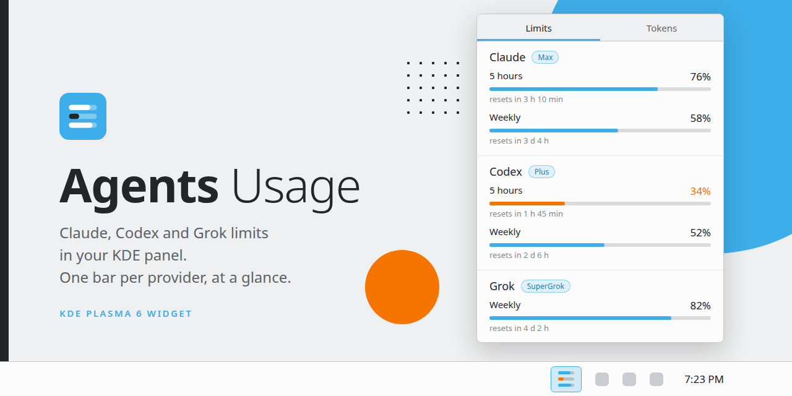

# Agents Usage

Claude, Codex and Grok usage limits in your KDE Plasma 6 panel: one bar per provider in the tray, the details one click away.

[](https://github.com/YakupEmreYerli/kde-agents-usage/actions/workflows/ci.yml)
[](LICENSE)




[Türkçe](README.tr.md)

## What this fork adds

This is a fork of [yusufipk/kde-agents-usage](https://github.com/yusufipk/kde-agents-usage). On top of the original it has:

- **Grok.** Limits and token history for Grok subscriptions next to Claude and Codex.
- **A three-bar tray icon.** The original shows one ring with the lowest number across all providers. Here each provider gets its own bar, from top to bottom Claude, Codex and Grok, showing what is left of its 5-hour window. A provider without a 5-hour window (Grok) shows its weekly one. A bar turns orange at 40% left and red under 15%.

Hover the icon for the numbers, click for the full view, middle click to refresh.

## What it shows

**Limits.** How much is left of every window each subscription has (5 hours, weekly, monthly, per-model), when it resets and the plan name. It refreshes every 5 minutes and whenever the popup opens. If a refresh fails, the last known values stay on screen marked as stale.

**Tokens.** Tokens by day and by model, counted from the local Claude Code, Codex and Grok logs, and what they would have cost at API list prices, cache included. Prices come from LiteLLM's public price list, fetched once a day; tokens from models with no known price are reported separately. The history only goes as far back as those tools keep their logs, and claude.ai chats are not in it. The cost is an estimate, not a subscription charge.

The text follows the system language, English or Turkish.


## Where the numbers come from

The widget uses the logins the command line tools already keep, so each one needs to be signed in once.

| Provider | Login it reads | Notes |
| --- | --- | --- |
| Claude | `~/.claude/.credentials.json` | Read only. After a long break from Claude Code the widget shows the last known numbers until you open `claude` again. |
| Codex | `~/.codex/auth.json` | An expired token is refreshed the way the CLI does it and written back to `auth.json`. |
| Grok | `~/.grok/auth.json` (`GROK_HOME` is respected) | Read only. Renew an expired session with `grok login`. |

Nothing is sent anywhere except to each provider's own usage endpoint and the LiteLLM price list.

## Install

Needs Plasma 6, `python3`, and `msgfmt` (gettext) for the Turkish translation.

```sh
git clone https://github.com/YakupEmreYerli/kde-agents-usage.git
cd kde-agents-usage
./install.sh
```

Then add "Agents Usage" to a panel (right click the panel, Add Widgets), or open the system tray arrow, Configure System Tray, and set it to always shown. To update, run `git pull && ./install.sh` and restart Plasma with `systemctl --user restart plasma-plasmashell`.

The fork keeps the original widget id, so installing it replaces the original widget in place.

## Tests

The Grok provider tests run without credentials or network access:

```sh
python3 -m unittest discover -s tests -v
```

## Credits

Built on [kde-agents-usage](https://github.com/yusufipk/kde-agents-usage) by Yusuf İpek, who wrote the widget, the Claude and Codex providers and the token view. Model prices come from the [LiteLLM](https://github.com/BerriAI/litellm) price list.

## License

[MIT](LICENSE)
