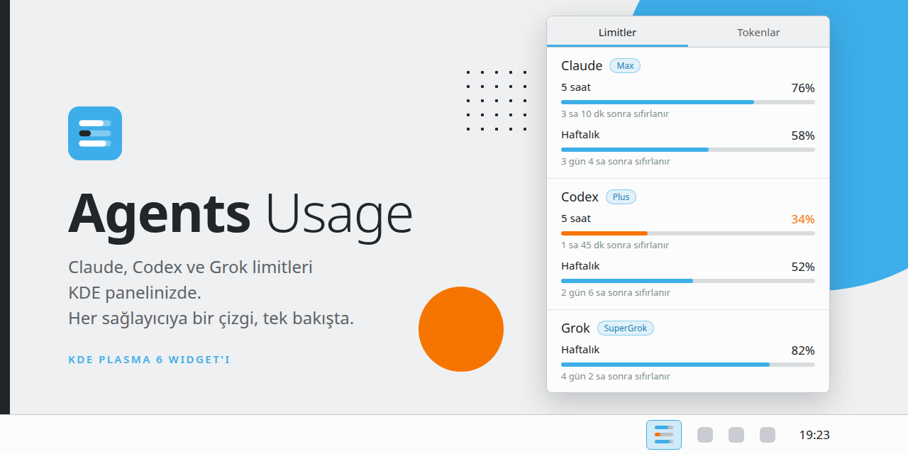

# Agents Usage

Claude, Codex ve Grok kullanım limitleri KDE Plasma 6 panelinizde: tepside her sağlayıcıya bir çizgi, ayrıntılar tek tık uzakta.

[](https://github.com/YakupEmreYerli/kde-agents-usage/actions/workflows/ci.yml)
[](LICENSE)




[English](README.md)

## Bu fork ne ekliyor

[yusufipk/kde-agents-usage](https://github.com/yusufipk/kde-agents-usage) deposunun forkudur. Asıl sürümün üstüne şunlar var:

- **Grok.** Claude ve Codex'in yanında Grok aboneliğinin limitleri ve token geçmişi.
- **Üç çizgili tepsi ikonu.** Asıl sürüm tek bir halka gösterir: bütün sağlayıcılar içindeki en düşük sayı. Burada her sağlayıcının kendi çizgisi var; üstten alta Claude, Codex ve Grok, 5 saatlik limitten ne kadar kaldığını gösterir. 5 saatlik limiti olmayan sağlayıcıda (Grok) haftalık limit görünür. Çizgi %40 kalınca turuncuya, %15'in altında kırmızıya döner.

Sayılar için ikonun üstüne gelin, tam görünüm için tıklayın, yenilemek için orta tuşla tıklayın.

## Ne gösterir

**Limitler.** Her aboneliğin her penceresinden (5 saat, haftalık, aylık, modele özel) ne kadar kaldığı, ne zaman sıfırlanacağı ve paketin adı. 5 dakikada bir ve pencere her açıldığında yenilenir. Yenileme başarısız olursa son bilinen değerler "eski" işaretiyle ekranda kalır.

**Tokenlar.** Bilgisayardaki Claude Code, Codex ve Grok kayıtlarından sayılan, güne ve modele göre token kullanımı; bir de bunların API liste fiyatıyla, önbellek dahil, kaça geleceği. Fiyatlar LiteLLM'in herkese açık fiyat listesinden günde bir kez alınır; fiyatı bilinmeyen modellerin tokenları ayrı yazılır. Geçmiş, bu araçların kayıt tuttuğu kadar geriye gider; claude.ai sohbetleri dahil değildir. Tutar bir tahmindir, abonelik ücreti değildir.

Arayüz sistem dilini izler: Türkçe ya da İngilizce.


## Sayılar nereden geliyor

Widget, komut satırı araçlarının zaten tuttuğu oturumları kullanır; her birine bir kez giriş yapılmış olması yeter.

| Sağlayıcı | Okuduğu oturum | Not |
| --- | --- | --- |
| Claude | `~/.claude/.credentials.json` | Yalnız okunur. Claude Code uzun süre açılmadıysa, `claude` yeniden açılana kadar son bilinen sayılar görünür. |
| Codex | `~/.codex/auth.json` | Süresi dolan token, CLI'ın yaptığı gibi yenilenir ve `auth.json`'a geri yazılır. |
| Grok | `~/.grok/auth.json` (`GROK_HOME` dikkate alınır) | Yalnız okunur. Süresi dolan oturum `grok login` ile yenilenir. |

Her sağlayıcının kendi kullanım adresi ve LiteLLM fiyat listesi dışında hiçbir yere veri gönderilmez.

## Kurulum

Plasma 6, `python3` ve Türkçe çeviri için `msgfmt` (gettext) gerekir.

```sh
git clone https://github.com/YakupEmreYerli/kde-agents-usage.git
cd kde-agents-usage
./install.sh
```

Sonra "Ajan Limitleri"ni bir panele ekleyin (panele sağ tıklayıp Widget Ekle) ya da sistem tepsisindeki oktan Sistem Tepsisini Yapılandır'ı açıp "her zaman göster" yapın. Güncellemek için `git pull && ./install.sh` çalıştırıp Plasma'yı `systemctl --user restart plasma-plasmashell` ile yeniden başlatın.

Forkun kendi widget kimliği var; asıl widget'ın yerine geçmez, yanına kurulur.

## Testler

Grok testleri oturum ve ağ gerektirmeden çalışır:

```sh
python3 -m unittest discover -s tests -v
```

## Emeği geçenler

[kde-agents-usage](https://github.com/yusufipk/kde-agents-usage) üzerine kuruldu; widget'ı, Claude ve Codex bölümlerini ve token görünümünü Yusuf İpek yazdı. Model fiyatları [LiteLLM](https://github.com/BerriAI/litellm) fiyat listesinden gelir.

## Lisans

[MIT](LICENSE)
